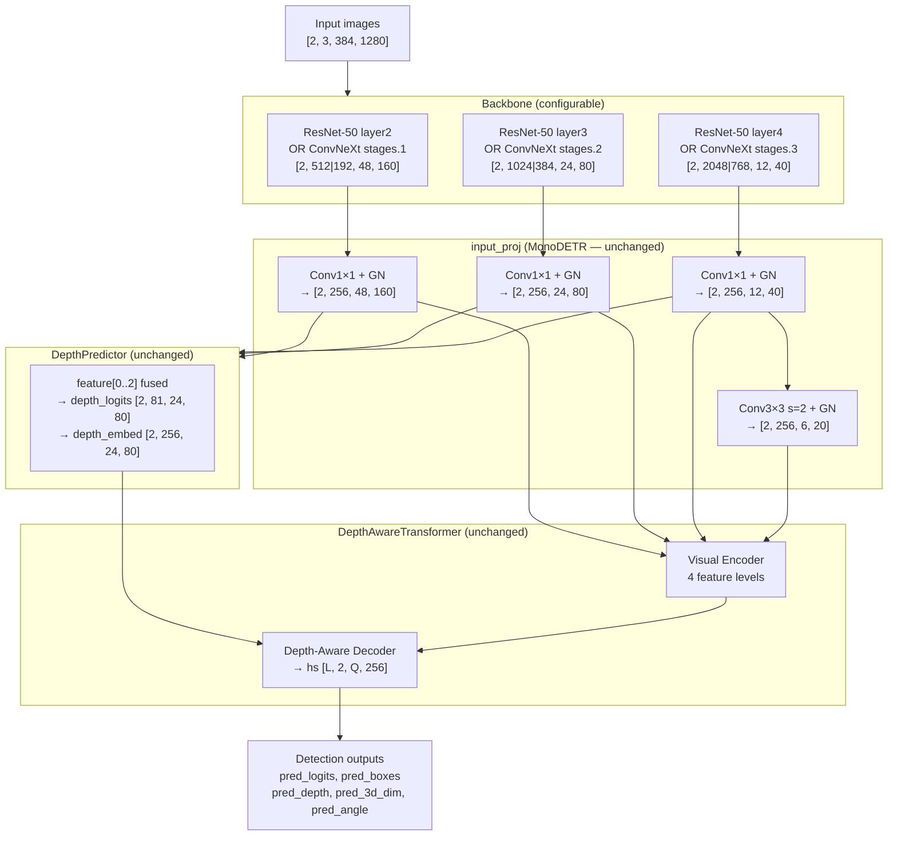
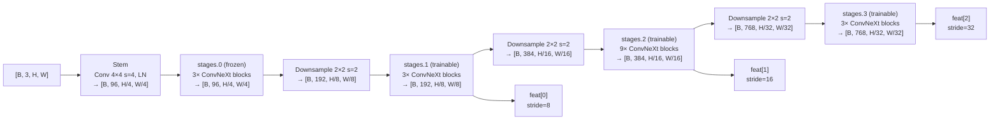
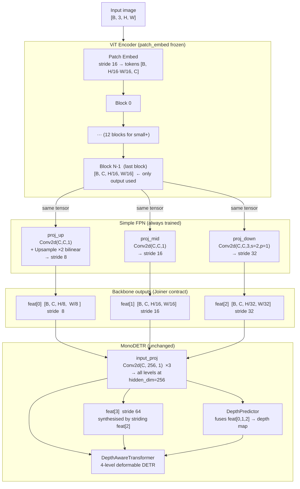

# DINOv3 ConvNeXt-tiny Backbone Integration Plan

## 1. Goal

Replace (or offer as a configurable alternative to) the ResNet-50 backbone in MonoDETR with
**DINOv3-pretrained ConvNeXt-tiny** (`convnext_tiny.dinov3_lvd1689m`).

HuggingFace model card: `facebook/dinov3-convnext-tiny-pretrain-lvd1689m`  
timm ID: `convnext_tiny.dinov3_lvd1689m`

---

## 2. Architecture Investigation

### 2.1 Current ResNet-50 Backbone (MonoDETR default)

`BackboneBase` wraps ResNet-50 via `torchvision.models.resnet50` + `IntermediateLayerGetter`.

| Layer  | Output stride | Channels |
|--------|--------------|----------|
| layer2 | 8            | 512      |
| layer3 | 16           | 1024     |
| layer4 | 32           | 2048     |

Freezing policy (`train_backbone=True`): stem + layer1 frozen; layer2-4 trainable.

### 2.2 DINOv3 ConvNeXt-tiny

Self-supervised (DINO v3) pretrained on LVD-142M+1689M crops via timm.

Full ConvNeXt-tiny stage layout:

| Stage    | Output stride | Channels | Used as backbone output |
|----------|--------------|----------|-------------------------|
| stages.0 | 4            | 96       | No (frozen, internal)   |
| stages.1 | 8            | 192      | ✓ feat[0]               |
| stages.2 | 16           | 384      | ✓ feat[1]               |
| stages.3 | 32           | 768      | ✓ feat[2]               |

Number of parameters: ~28 M (comparable to ResNet-50 ~25 M).

**Key difference:** ConvNeXt uses `LayerNorm` throughout — `FrozenBatchNorm2d` is not needed.

---

## 3. Integration Feasibility

The integration is **clean and minimally invasive** because:

1. The backbone's contract with the rest of MonoDETR is entirely captured by two properties:
   - `backbone.strides` — list of int
   - `backbone.num_channels` — list of channel widths
2. DINOv3 ConvNeXt-tiny at `out_indices=(1,2,3)` produces the **exact same strides** [8, 16, 32]
   as ResNet-50 (layer2/3/4). Only the channel widths differ.
3. `input_proj` in `MonoDETR.__init__` already projects every backbone channel to `hidden_dim=256`
   using per-level `Conv2d(in_channels, hidden_dim, 1)`. Swapping `num_channels` is all that is needed.
4. The 4th feature level (stride 64) is auto-synthesised inside `monodetr.py` by striding the
   last backbone output — this logic is **unchanged**.
5. `DepthPredictor`, `DepthAwareTransformer`, `Joiner`, position encoding — all **unchanged**.

The only file that needs new code is `lib/models/monodetr/backbone.py` (+ config + requirements).

---

## 4. Data Flow Diagram

### 4.1 Full forward pass — tensor shapes for batch=2, H=384, W=1280



### 4.2 DINOv3 ConvNeXt-tiny backbone internals



---

## 5. Code Changes Required

### 5.1 `lib/models/monodetr/backbone.py`

Add `DINOv3Backbone` class alongside the existing `Backbone` (ResNet):

```python
class DINOv3Backbone(nn.Module):
    """ConvNeXt-tiny pretrained with DINOv3, used as a feature extractor."""

    strides: List[int]
    num_channels: List[int]

    def __init__(self, model_name: str, train_backbone: bool):
        super().__init__()
        # timm features_only=True, out_indices=(1,2,3) → strides [8,16,32]
        self.body = timm.create_model(
            model_name, pretrained=True, features_only=True, out_indices=(1, 2, 3)
        )
        self.strides = self.body.feature_info.reduction()    # [8, 16, 32]
        self.num_channels = self.body.feature_info.channels()  # [192, 384, 768]

        # Freeze stem + stages.0; optionally freeze all
        for name, param in self.body.named_parameters():
            if train_backbone and not name.startswith("stages.0"):
                continue
            param.requires_grad_(False)

    def forward(self, images: torch.Tensor) -> Dict[str, NestedTensor]:
        feats = self.body(images)
        out = {}
        for i, x in enumerate(feats):
            mask = torch.zeros(x.shape[0], x.shape[2], x.shape[3],
                               dtype=torch.bool, device=x.device)
            out[str(i)] = NestedTensor(x, mask)
        return out
```

Update `build_backbone`:

```python
def build_backbone(cfg):
    position_embedding = build_position_encoding(cfg)
    return_interm_layers = cfg['masks'] or cfg['num_feature_levels'] > 1
    backbone_name = cfg['backbone']

    if backbone_name.startswith('convnext') or 'dinov3' in backbone_name:
        backbone = DINOv3Backbone(backbone_name, cfg['train_backbone'])
    else:
        backbone = Backbone(backbone_name, cfg['train_backbone'],
                            return_interm_layers, cfg['dilation'])

    return Joiner(backbone, position_embedding)
```

### 5.2 `configs/monodetr.yaml`

```yaml
model:
  backbone: 'convnext_tiny.dinov3_lvd1689m'   # was: 'resnet50'
```

### 5.3 `requirements.txt`

Add `timm` (already installed as a transitive dependency of transformers, but make explicit).

---

## 6. What Does NOT Change

| Component | Reason unchanged |
|-----------|-----------------|
| `input_proj` (MonoDETR) | Projects any channel count to `hidden_dim=256` |
| 4th feature level synthesis | Already done inside `monodetr.py` by striding layer[-1] |
| `DepthPredictor` | Consumes 4 projected `[B, 256, ...]` feature maps |
| `DepthAwareTransformer` | Operates on projected features only |
| `Joiner` | Backbone-agnostic wrapper |
| Position encoding | Computed from feature map spatial dims, not channel count |
| `tester_helper`, `trainer_helper` | No backbone-dependent logic |

---

## 7. Potential Risks & Mitigations

| Risk | Mitigation |
|------|-----------|
| ConvNeXt uses LayerNorm (not BatchNorm) — frozen BN not applicable | No action needed; ConvNeXt's own LN normalises correctly during training |
| Lower channel counts (192/384/768 vs 512/1024/2048) may reduce expressiveness at input_proj | Minor concern; `hidden_dim=256` is smaller than all backbone channels so projection is equally compressive; DINOv3 pretraining compensates |
| `dilation` flag used by ResNet is not applicable to ConvNeXt | Guard in `build_backbone` routes dilation-aware path only to ResNet |
| Pretrained weights require internet access at first run | Standard timm behaviour; weights cached in `~/.cache/huggingface/hub` |
| `resume_model` with ResNet checkpoint incompatible with ConvNeXt | Expected; separate runs per backbone; checkpoints are not cross-compatible |

---

## 8. Implementation Steps (ordered)

1. **`backbone.py`** — add `DINOv3Backbone` class + update `build_backbone()`
2. **`requirements.txt`** — add `timm`
3. **`configs/monodetr.yaml`** — expose `backbone` key with new default or keep `resnet50`
4. **Smoke-test** — instantiate model with ConvNeXt backbone, run a forward pass with dummy data

---

## 9. Training-Loop Visualizations

### 9.1 Goal

During training, every `eval_frequency` epochs (default 10):
- Run the test split through the model
- Log quantitative metrics to TensorBoard
- Log **image panels** showing detected 2-D bboxes
- Log **depth cross-attention heatmaps** (A_D) matching Figure 6 of the
  MonoDETR paper (https://arxiv.org/pdf/2203.13310)

### 9.2 New file: `lib/helpers/vis_helper.py`

```
lib/helpers/vis_helper.py
├── _denorm(img)               — undo ImageNet normalisation
├── _to_uint8(img)
├── _apply_colormap(heatmap)   — 'inferno' via matplotlib (greyscale fallback)
├── _get_model_core(model)     — unwrap DataParallel
│
├── log_detection_images(...)  — draw pred_boxes on first N test images → TB
│     pred_boxes [B,Q,6] in [cx,cy,l,r,t,b] normalised format
│     converted via box_cxcylrtb_to_xyxy() → pixel xyxy, then
│     torchvision.utils.draw_bounding_boxes
│
└── log_depth_attn_maps(...)   — A_D heatmap overlay → TB
      registers a forward hook on
        depthaware_transformer.decoder.layers[-1].cross_attn_depth
        (nn.MultiheadAttention in DepthAwareDecoderLayer)
      hook captures (attn_output, attn_weights) — attn_weights shape:
        [B, num_queries, H_d*W_d]  where H_d = H_img//16, W_d = W_img//16
      top-scoring query per image → reshape to [H_d, W_d] →
        bilinear upsample to image size → inferno colormap →
        alpha-blend (60% image + 40% heatmap)
      hook is registered and removed around a single forward pass so
      training is not affected
```

### 9.3 Changes to `lib/helpers/tester_helper.py`

| Change | Location |
|--------|----------|
| Accept `tb_writer` kwarg (default `None`) | `Tester.__init__` |
| Accept `vis_n_images` from `train_cfg` | `Tester.__init__` via `train_cfg.get('vis_n_images', 4)` |
| Fix `output_dir` | use `run_dir` key instead of stale `timestamp` key |
| Replace bare `print()` with `self.logger.info()` | `inference()` |
| New method `visualize(epoch)` | calls `log_detection_images` + `log_depth_attn_maps` on first test batch |

```python
# lib/helpers/tester_helper.py  (new method)
def visualize(self, epoch: int) -> None:
    if self.tb_writer is None:
        return
    inputs, calibs, targets, info = next(iter(self.dataloader))
    # ... move to device ...
    outputs = self.model(inputs, calibs, targets, img_sizes, dn_args=0)
    log_detection_images(self.tb_writer, 'vis/detections', ...)  # no hooks
    log_depth_attn_maps(self.tb_writer,  'vis/depth_attn', ...)  # with hook
```

### 9.4 Changes to `lib/helpers/trainer_helper.py`

Eval is **decoupled** from checkpoint saves:

```python
# save every save_frequency epochs (unchanged)
if (self.epoch % self.cfg['save_frequency']) == 0:
    save_checkpoint(...)

# eval every eval_frequency epochs (new — independent of saves)
eval_freq = self.cfg.get('eval_frequency', self.cfg['save_frequency'])
if self.tester is not None and (self.epoch % eval_freq) == 0:
    self.tester.inference()
    cur_result = self.tester.evaluate()
    self.tb_writer.add_scalar('eval/metric', cur_result, self.epoch)
    # save best checkpoint if improved
    if cur_result > best_result:
        save_checkpoint(..., 'checkpoint_best')
    self.tester.visualize(self.epoch)   # ← new
```

### 9.5 Changes to `tools/train_val.py`

```python
tester = Tester(..., tb_writer=trainer.tb_writer)   # pass writer
```

### 9.6 Config keys added (all configs)

```yaml
trainer:
  save_frequency: 5       # checkpoint save interval (epochs)
  eval_frequency: 10      # run test evaluation every N epochs
  vis_n_images: 4         # images to show in TensorBoard detection/attn panels
```

### 9.7 TensorBoard tags written

| Tag | Content |
|-----|---------|
| `train/loss_total` | weighted sum of all losses (per step) |
| `train/losses/<key>` | per-loss-component (per step) |
| `train/lr` | learning rate (per epoch) |
| `eval/metric` | test AP scalar (every `eval_frequency` epochs) |
| `vis/detections` | image grid with predicted 2-D bbox overlays |
| `vis/depth_attn` | A_D heatmap grid (depth cross-attention of top query) |

### 9.8 A_D Hook – how it works

```
DepthAwareDecoderLayer.forward()
  └── self.cross_attn_depth(                        ← nn.MultiheadAttention
          query = tgt.T,                            [L, B, 256]
          key   = depth_pos_embed,                  [H_d*W_d, B, 256]
          value = depth_pos_embed,
          key_padding_mask = mask_depth
      )[0]   ← Python [0] discards weights AFTER forward() returns

forward_hook receives output = (attn_output, attn_weights)
  attn_weights shape: [B, num_queries, H_d*W_d]    (avg over heads)

Hook is registered on layers[-1] only (most refined decoder layer).
Hook is active for ONE forward pass, then removed.
No gradients are affected; training is unmodified.
```

---

## 10. ViT DINOv3 Backbone + Simple FPN

### 10.1 The problem: ViT is isotropic

ConvNeXt is a *hierarchical* network — its four stages naturally produce
feature maps at strides 4, 8, 16, and 32.  A plain ViT (`vit_small_plus`,
`vit_base`, etc.) is *isotropic*: all transformer blocks operate on the
same 2-D token grid at a fixed stride equal to the patch size (16 px for
patch16 models).  Inspecting the timm feature info confirms this:

```
vit_small_plus_patch16_dinov3.lvd1689m
  block 0  → reduction=16, channels=384
  block 1  → reduction=16, channels=384
  ...
  block 11 → reduction=16, channels=384
```

All 12 blocks live at stride 16 with identical channel count.  There are
no native stride-8 or stride-32 feature maps — so the `features_only`
API with `out_indices=(1, 2, 3)` that works for ConvNeXt would give three
*identical-resolution* tensors (all `[B, 384, H/16, W/16]`), which is not
a useful multi-scale representation.

### 10.2 What MonoDETR needs from the backbone

`Joiner` (the backbone wrapper) must expose:

| Level | Stride | Purpose in MonoDETR |
|-------|--------|---------------------|
| feat[0] | 8 | sent to `DepthPredictor` as the fine-grained level; used in the FPN-style depth fusion |
| feat[1] | 16 | primary depth feature; `DepthPredictor` fuses stride-8/16/32 around this |
| feat[2] | 32 | coarse context |
| feat[3] | 64 | synthesised inside `monodetr.py` by striding feat[2] — **not** needed from backbone |

Only three levels need to come from the backbone; `monodetr.py` generates
the 4th automatically.

### 10.3 Solution: Simple FPN (ViTDet, He et al. 2022)

Rather than sampling three scaffold-conv blocks from ViT's internal blocks
at different depths (which only gives isotropic scale), we take the *last*
(most semantically rich) block output and derive multi-scale maps from it
with lightweight projection heads — the approach introduced in
[ViTDet](https://arxiv.org/abs/2203.16527) [1].

#### Architecture diagram



All three FPN heads draw from the **same** last-block feature — no
information is discarded by skipping intermediate blocks.  The 1×1 convs
are near-zero cost; the 3×3 strided conv for stride-32 adds only
`C × C × 9` parameters (≈3.3 M for small+, ≈5.3 M for base).

### 10.4 Why not use intermediate blocks?

Two alternatives were considered and rejected:

| Alternative | Problem |
|-------------|---------|
| Sample blocks 3, 7, 11 at `out_indices=(3, 7, 11)` | All still at stride 16 — same scale, no multi-resolution benefit |
| Train separate stride-8 / stride-32 token streams | Requires architectural changes (windowed attention, etc.) — far too invasive |

Simple FPN is the standard solution for attaching single-scale ViT backbones
to multi-scale detection heads (used in ViTDet [1], EVA-02 [2], DINOv2-det [3]).

### 10.5 Freezing policy

| Sub-module | Frozen? | Reason |
|------------|---------|--------|
| `patch_embed` | Always | Encodes spatial positions; the stride-16 grid structure must be stable |
| Transformer blocks | `train_backbone` flag | All blocks are semantically equivalent scales; freezing all prevents overfitting on small datasets like KITTI |
| `proj_up / proj_mid / proj_down` | Never frozen | These are new randomly-initialised heads; must always train |

### 10.6 Channel dimensions produced

| timm model | embed_dim | num_channels (all three levels) |
|-----------|-----------|----------------------------------|
| `vit_small_plus_patch16_dinov3.lvd1689m` | 384 | [384, 384, 384] |
| `vit_base_patch16_dinov3.lvd1689m` | 768 | [768, 768, 768] |
| `vit_large_patch16_dinov3.lvd1689m` | 1024 | [1024, 1024, 1024] |

Unlike ConvNeXt (which has different widths per stage), all three FPN
levels have *equal* channel count.  `input_proj` in `MonoDETR.__init__`
projects each to `hidden_dim=256` regardless, so this is transparent to
the rest of the model.

### 10.7 Routing in `build_backbone`

```python
# lib/models/monodetr/backbone.py

def build_backbone(cfg):
    backbone_name = cfg['backbone']

    if backbone_name.startswith('vit_') and ('dinov3' in backbone_name or 'dinov2' in backbone_name):
        backbone = ViTDINOv3Backbone(backbone_name, cfg['train_backbone'])   # ← Simple FPN path
    elif backbone_name.startswith('convnext'):
        backbone = DINOv3Backbone(backbone_name, cfg['train_backbone'])      # ← hierarchical path
    else:
        backbone = Backbone(backbone_name, ...)                              # ← ResNet path
```

The check `vit_` prefix + `dinov3|dinov2` in the name is intentional: it
covers all current timm DINOv2/v3 ViT variants while leaving the door open
for non-DINO ViT backbones (which might need different handling).

### 10.8 Verified forward-pass shapes

With a KITTI-sized input `[2, 3, 384, 1280]`:

```
ViTDINOv3Backbone('vit_small_plus_patch16_dinov3.lvd1689m')

  ViT last block:  [2, 384, 24, 80]   (stride 16)

  proj_up  → [2, 384, 48, 160]        (stride  8)   ← feat[0]
  proj_mid → [2, 384, 24,  80]        (stride 16)   ← feat[1]
  proj_down→ [2, 384, 12,  40]        (stride 32)   ← feat[2]

  strides:      [8, 16, 32]   ✓  (matches ConvNeXt / ResNet contract)
  num_channels: [384, 384, 384]
```

### 10.9 References

[1] **ViTDet** — He, K., Chen, X., Xie, S., Li, Y., Dollár, P., Girshick, R.
    *Exploring Plain Vision Transformer Backbones for Object Detection.*
    ECCV 2022. https://arxiv.org/abs/2203.16527
    > Proposes Simple FPN: project the single-scale ViT feature to
    > stride 8/16/32/64 with lightweight conv heads, enabling
    > Mask R-CNN / Cascade Mask R-CNN on plain ViT without any
    > hierarchical backbone modifications.

[2] **EVA-02** — Fang, Y. et al.
    *EVA-02: A Visual Representation Powerhouse with MIM Pretraining and
    Scaling Up.*
    arXiv 2023. https://arxiv.org/abs/2303.11331
    > Applies Simple FPN to a large-scale MIM-pretrained ViT for
    > COCO detection, confirming the approach generalises beyond
    > supervised pretraining.

[3] **DINOv2** — Oquab, M. et al.
    *DINOv2: Learning Robust Visual Features without Supervision.*
    TMLR 2024. https://arxiv.org/abs/2304.07193
    > Section 6.3 evaluates DINOv2 ViT backbones on object detection
    > with a Simple FPN head, establishing strong baselines for
    > self-supervised ViT features in detection.

[4] **MonoDETR** — Zhang, R. et al.
    *MonoDETR: Depth-aware Transformer for Monocular 3D Object Detection.*
    ICCV 2023. https://arxiv.org/abs/2203.13310
    > Source architecture; defines the DepthPredictor + DepthAwareTransformer
    > pipeline that requires 3-level multi-scale backbone features.

[5] **DINOv3 (DeiT III)** — Touvron, H. et al.
    *DeiT III: Revenge of the ViT.*
    ECCV 2022. https://arxiv.org/abs/2204.07118
    > Supervised pretraining recipe for "DINOv3" ViT models available
    > in timm (the `lvd1689m` suffix refers to the LVD-1689M dataset
    > used for the follow-on self-supervised stage).

---

## 11. Why ConvNeXt Trains Better than ViT, and the Intermediate-block FPN Fix

### 11.1 Observation

Early loss curves show DINOv3 ConvNeXt variants (tiny / small) converging faster
and producing lower detection losses than `vit_small_plus_patch16_dinov3` under
identical training settings.  This section explains the root causes and documents
the architectural fix that was implemented.

### 11.2 Root Causes

#### 11.2.1 Semantic Homogeneity in Simple FPN

Simple FPN (used in the initial ViT implementation) feeds **the same last-block
tensor** through three spatial-adaptation heads:

```
last block output [B, C, H/16, W/16]
    ├── Conv + ×2 upsample  → "stride-8 level"  (shallow spatial, DEEP semantics)
    ├── Conv pass-through   → "stride-16 level" (shallow spatial, DEEP semantics)
    └── Conv + stride-2     → "stride-32 level" (shallow spatial, DEEP semantics)
```

Although the three tensors differ spatially, they carry **identical semantic
depth**.  The FPN cross-scale interaction that makes real multi-scale backbones
powerful relies on semantically distinct levels: fine-resolution levels hold
local/textural cues and coarse levels hold category-level context.  When all
three levels originate from the same feature the FPN effectively becomes a
single-scale detector with spatial interpolation, which is a known failure mode
for localization-heavy tasks such as monocular 3D detection.

#### 11.2.2 Patch-16 Resolution Floor

ViT with `patch_size=16` fixes the native feature resolution at H/16, W/16 — for
KITTI images (384 × 1280) that is 24 × 80 pixels.  The stride-8 level in Simple
FPN is produced by *upsampling* from this grid, not by genuinely computing
features at the higher resolution.  ConvNeXt computes real stride-8 features
inside its Stage 2 (after two downsampling steps from the input), so its
stride-8 level contains actual high-frequency spatial information.

#### 11.2.3 Pretraining Objective Bias

DINOv3 ViTs are trained with a global self-distillation objective that encourages
**invariance to local crops**, making the learned representations very good at
image-level recognition but less tuned for precise spatial localization.  By
contrast, DINOv3 ConvNeXt models are trained with a DeiT-III supervised recipe
that retains spatially sharp gradients throughout the convolutional hierarchy.
The pretraining bias translates directly to faster convergence on spatially
demanding tasks like 3D bounding-box regression.

### 11.3 Alternative Approaches (Ranked by Ease)

| Approach | Effort | Expected gain | Notes |
|---|---|---|---|
| **Intermediate-block FPN** (implemented) | Low | Moderate | Semantic diversity at no architecture change |
| `vit_base_patch14_reg4_dinov2.lvd142m` | Zero code | High? | patch14 → stride-14 native; reg4 tokens reduce background noise |
| Swin Transformer (timm `swinv2_*`) | Low | High | Hierarchical like ConvNeXt; genuine multi-scale |
| ViTDet-faithful (windowed attention + global blocks) | Medium | High | Matches original ViTDet paper design |
| EVA-02 + FPN | Medium | High | EVA-02 was designed for detection pretraining |

The `vit_base_patch14_reg4_dinov2` option is worth trying with zero code
changes — the smaller patch size naturally yields a 27 × 91 base grid instead
of 24 × 80, and register tokens [6] suppress the background-artifact problem
that degrades localization in plain DINO ViTs.

### 11.4 Intermediate-block FPN (Implemented)

The fix upgrades `ViTDINOv3Backbone` to extract features at *three semantically
distinct depths* and then apply the same spatial adapters:

```
Block ≈ N/3  (early — local / textural)  ─→ Conv + ×2 upsample → stride 8
Block ≈ 2N/3 (middle — balanced)          ─→ Conv pass-through  → stride 16
Block ≈ N    (late  — high-level semantic) ─→ Conv + stride-2    → stride 32
```

For `vit_small_plus_patch16_dinov3` (12 blocks) this resolves to `out_indices=(3, 7, 11)`.

**Why this helps:**

* The stride-8 level now comes from block 3, which retains more local/textural
  edge information — better for small objects and precise boundary localization.
* The stride-32 level comes from block 11, the most abstract representation —
  appropriate for category-level context in the coarsest detection head.
* The three `nn.Conv2d` heads now receive genuinely different inputs, so their
  gradients are decorrelated and the FPN learned representation is richer.

**Block index derivation** is automatic from the model's `feature_info` length,
so the same code works for any ViT depth (6-block / 12-block / 24-block):

```python
n_blocks = len(timm.create_model(model_name, pretrained=False, features_only=True).feature_info)
i_early  = n_blocks // 3 - 1    # ≈ 33 % depth
i_mid    = 2 * n_blocks // 3 - 1 # ≈ 67 % depth
i_last   = n_blocks - 1          # 100 % depth
```

**Verified output shapes** (384 × 1280 input, `vit_small_plus_patch16_dinov3`):

```
level 0 (stride  8): [B, 384, 48, 160]
level 1 (stride 16): [B, 384, 24,  80]
level 2 (stride 32): [B, 384, 12,  40]
```

### 11.5 Remaining Limitations

Even with Intermediate-block FPN the ViT still cannot match genuine stride-8
computation.  If training curves remain worse than ConvNeXt, the recommended
next step is to try `vit_base_patch14_reg4_dinov2.lvd142m` — no code change
required, just swap the `backbone` key in the config.

### 11.6 References

[6] **Vision Transformers Need Registers** — Darcet, T. et al.
    ICLR 2024. https://arxiv.org/abs/2309.16588
    > Register tokens suppress artifact activations in background patches of
    > ViT feature maps, improving localization quality.
