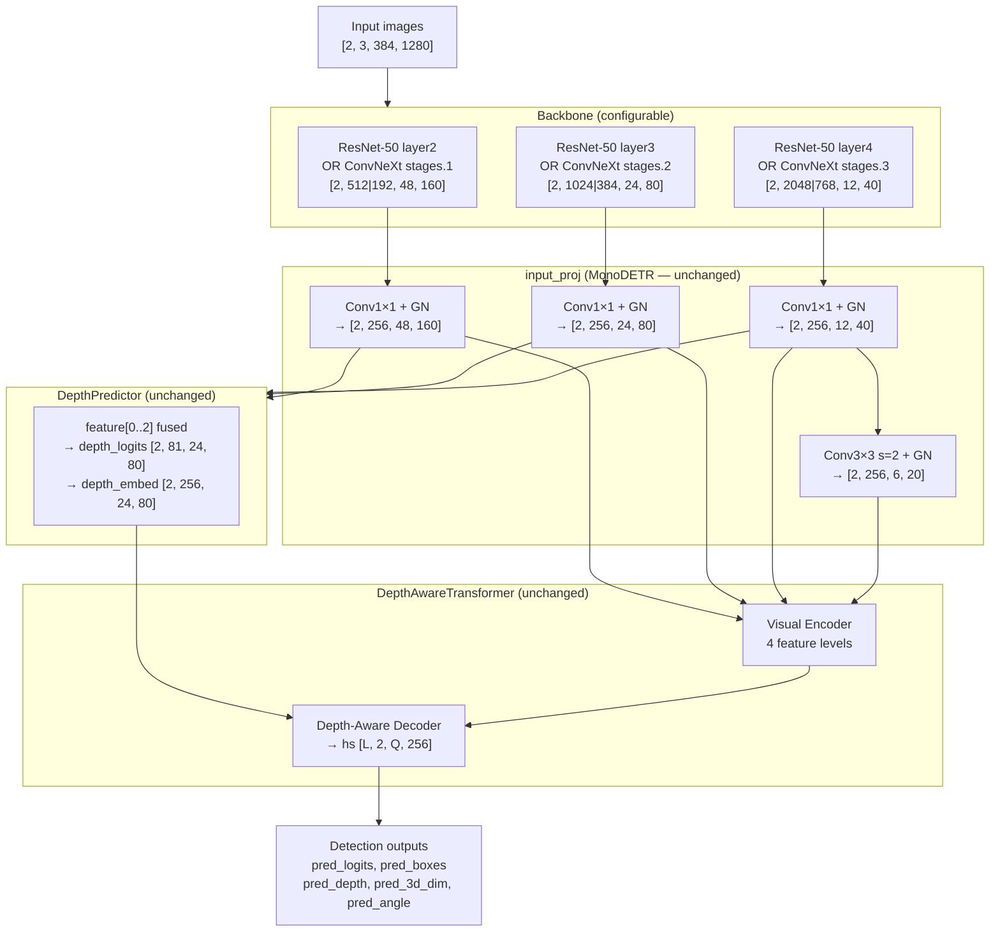
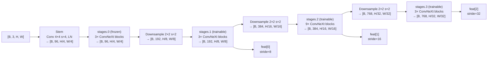

# DINOv3 ConvNeXt-tiny Backbone Integration Plan

## 1. Goal

Replace (or offer as a configurable alternative to) the ResNet-50 backbone in MonoDETR with
**DINOv3-pretrained ConvNeXt-tiny** (`convnext_tiny.dinov3_lvd1689m`).

HuggingFace model card: `facebook/dinov3-convnext-tiny-pretrain-lvd1689m`  
timm ID: `convnext_tiny.dinov3_lvd1689m`

---

## 2. Architecture Investigation

### 2.1 Current ResNet-50 Backbone (MonoDETR default)

`BackboneBase` wraps ResNet-50 via `torchvision.models.resnet50` + `IntermediateLayerGetter`.

| Layer  | Output stride | Channels |
|--------|--------------|----------|
| layer2 | 8            | 512      |
| layer3 | 16           | 1024     |
| layer4 | 32           | 2048     |

Freezing policy (`train_backbone=True`): stem + layer1 frozen; layer2-4 trainable.

### 2.2 DINOv3 ConvNeXt-tiny

Self-supervised (DINO v3) pretrained on LVD-142M+1689M crops via timm.

Full ConvNeXt-tiny stage layout:

| Stage    | Output stride | Channels | Used as backbone output |
|----------|--------------|----------|-------------------------|
| stages.0 | 4            | 96       | No (frozen, internal)   |
| stages.1 | 8            | 192      | ✓ feat[0]               |
| stages.2 | 16           | 384      | ✓ feat[1]               |
| stages.3 | 32           | 768      | ✓ feat[2]               |

Number of parameters: ~28 M (comparable to ResNet-50 ~25 M).

**Key difference:** ConvNeXt uses `LayerNorm` throughout — `FrozenBatchNorm2d` is not needed.

---

## 3. Integration Feasibility

The integration is **clean and minimally invasive** because:

1. The backbone's contract with the rest of MonoDETR is entirely captured by two properties:
   - `backbone.strides` — list of int
   - `backbone.num_channels` — list of channel widths
2. DINOv3 ConvNeXt-tiny at `out_indices=(1,2,3)` produces the **exact same strides** [8, 16, 32]
   as ResNet-50 (layer2/3/4). Only the channel widths differ.
3. `input_proj` in `MonoDETR.__init__` already projects every backbone channel to `hidden_dim=256`
   using per-level `Conv2d(in_channels, hidden_dim, 1)`. Swapping `num_channels` is all that is needed.
4. The 4th feature level (stride 64) is auto-synthesised inside `monodetr.py` by striding the
   last backbone output — this logic is **unchanged**.
5. `DepthPredictor`, `DepthAwareTransformer`, `Joiner`, position encoding — all **unchanged**.

The only file that needs new code is `lib/models/monodetr/backbone.py` (+ config + requirements).

---

## 4. Data Flow Diagram

### 4.1 Full forward pass — tensor shapes for batch=2, H=384, W=1280



### 4.2 DINOv3 ConvNeXt-tiny backbone internals



---

## 5. Code Changes Required

### 5.1 `lib/models/monodetr/backbone.py`

Add `DINOv3Backbone` class alongside the existing `Backbone` (ResNet):

```python
class DINOv3Backbone(nn.Module):
    """ConvNeXt-tiny pretrained with DINOv3, used as a feature extractor."""

    strides: List[int]
    num_channels: List[int]

    def __init__(self, model_name: str, train_backbone: bool):
        super().__init__()
        # timm features_only=True, out_indices=(1,2,3) → strides [8,16,32]
        self.body = timm.create_model(
            model_name, pretrained=True, features_only=True, out_indices=(1, 2, 3)
        )
        self.strides = self.body.feature_info.reduction()    # [8, 16, 32]
        self.num_channels = self.body.feature_info.channels()  # [192, 384, 768]

        # Freeze stem + stages.0; optionally freeze all
        for name, param in self.body.named_parameters():
            if train_backbone and not name.startswith("stages.0"):
                continue
            param.requires_grad_(False)

    def forward(self, images: torch.Tensor) -> Dict[str, NestedTensor]:
        feats = self.body(images)
        out = {}
        for i, x in enumerate(feats):
            mask = torch.zeros(x.shape[0], x.shape[2], x.shape[3],
                               dtype=torch.bool, device=x.device)
            out[str(i)] = NestedTensor(x, mask)
        return out
```

Update `build_backbone`:

```python
def build_backbone(cfg):
    position_embedding = build_position_encoding(cfg)
    return_interm_layers = cfg['masks'] or cfg['num_feature_levels'] > 1
    backbone_name = cfg['backbone']

    if backbone_name.startswith('convnext') or 'dinov3' in backbone_name:
        backbone = DINOv3Backbone(backbone_name, cfg['train_backbone'])
    else:
        backbone = Backbone(backbone_name, cfg['train_backbone'],
                            return_interm_layers, cfg['dilation'])

    return Joiner(backbone, position_embedding)
```

### 5.2 `configs/monodetr.yaml`

```yaml
model:
  backbone: 'convnext_tiny.dinov3_lvd1689m'   # was: 'resnet50'
```

### 5.3 `requirements.txt`

Add `timm` (already installed as a transitive dependency of transformers, but make explicit).

---

## 6. What Does NOT Change

| Component | Reason unchanged |
|-----------|-----------------|
| `input_proj` (MonoDETR) | Projects any channel count to `hidden_dim=256` |
| 4th feature level synthesis | Already done inside `monodetr.py` by striding layer[-1] |
| `DepthPredictor` | Consumes 4 projected `[B, 256, ...]` feature maps |
| `DepthAwareTransformer` | Operates on projected features only |
| `Joiner` | Backbone-agnostic wrapper |
| Position encoding | Computed from feature map spatial dims, not channel count |
| `tester_helper`, `trainer_helper` | No backbone-dependent logic |

---

## 7. Potential Risks & Mitigations

| Risk | Mitigation |
|------|-----------|
| ConvNeXt uses LayerNorm (not BatchNorm) — frozen BN not applicable | No action needed; ConvNeXt's own LN normalises correctly during training |
| Lower channel counts (192/384/768 vs 512/1024/2048) may reduce expressiveness at input_proj | Minor concern; `hidden_dim=256` is smaller than all backbone channels so projection is equally compressive; DINOv3 pretraining compensates |
| `dilation` flag used by ResNet is not applicable to ConvNeXt | Guard in `build_backbone` routes dilation-aware path only to ResNet |
| Pretrained weights require internet access at first run | Standard timm behaviour; weights cached in `~/.cache/huggingface/hub` |
| `resume_model` with ResNet checkpoint incompatible with ConvNeXt | Expected; separate runs per backbone; checkpoints are not cross-compatible |

---

## 8. Implementation Steps (ordered)

1. **`backbone.py`** — add `DINOv3Backbone` class + update `build_backbone()`
2. **`requirements.txt`** — add `timm`
3. **`configs/monodetr.yaml`** — expose `backbone` key with new default or keep `resnet50`
4. **Smoke-test** — instantiate model with ConvNeXt backbone, run a forward pass with dummy data
